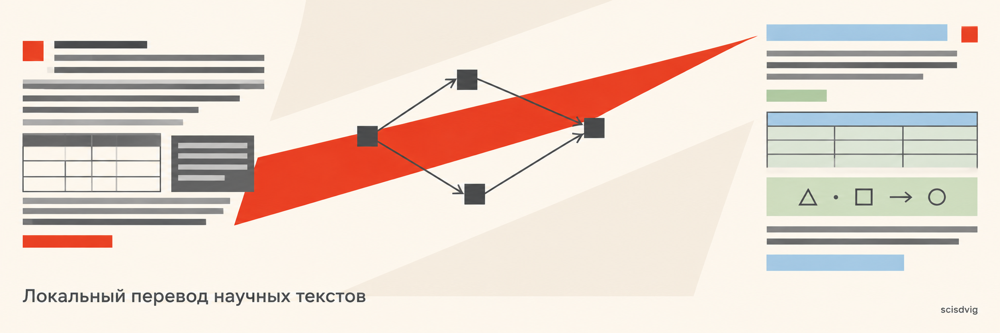

# scisdvig

> Локальный агент для структурированного перевода научной и технической литературы.

Проект спроектирован для сохранения семантики, структуры и разметки (формулы, таблицы, ссылки, код) при локальном переводе сложных текстов.



## Почему `scisdvig`?

Название образовано от **sci** (*science*) и **sdvig** (*translation shift*):

- **Sci** фиксирует предметную область: научная литература со строгими требованиями к терминологической точности.
- **Sdvig** — термин переводоведения (*translation shift*, J.C. Catford): осознанный и управляемый переход между языковыми структурами без искажения исходного смысла.

> Концепция также отсылает к эстетике авангарда столетней давности: динамика перехода, очищение от избыточных смыслов и точная композиция вместо приблизительного пересказа.

## Структура репозитория

```tree
├── CONTRIBUTING.md
├── LICENSE
├── README.md
├── backlog.md
└── docs
    ├── architecture.md
    ├── backlog.md
    ├── img/
    ├── requirements/
    │   ├── README.md
    │   ├── business.md
    │   ├── constraints.md
    │   ├── functional.md
    │   ├── llm-usage-accounting.md
    │   ├── non-functional.md
    │   ├── technical-stories.md
    │   └── user.md
    └── template_req.md
```
